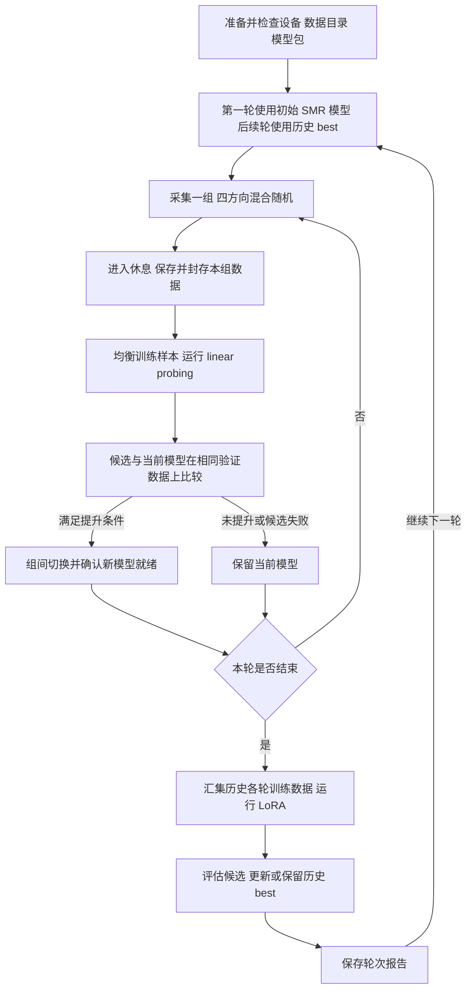

# 俄罗斯方块 EEG 采集与自适应微调方案

日期：2026 年 10 月 10 日  
状态：Proposal，流程设计待确认，尚未进入实现  
适用项目：Passive-BCI  
目标部署环境：Windows 原生，RTX 5060

## 项目目标

建立一条可以在采集现场直接使用的流程：受试者按随机方向提示完成 SMR 光标任务，系统分组保存 EEG 与事件，在休息期间进行样本均衡的 linear probing；候选模型经过评估，优于当前模型后接管后续采集。每轮结束后，用历史各轮的有效训练数据进行 LoRA，再为下一轮选择历史最佳模型。

该流程服务于俄罗斯方块的个体化脑控适配。第一阶段用明确方向提示和光标反馈获取可解释的标签，随后将经过验证的模型用于方块控制。方向类别到方块动作的具体映射，以及进入方块任务的条件，须在实现前确认。

同时，将推理、训练和模型管理整理为可安装的本地后端，使新采集机无需复现研究机的目录结构、个人 Conda 环境和散落的模型文件。

## 现状与问题

Passive-BCI 已提供新版实验目录、EEG 采集调试、会话库、SMR 与俄罗斯方块任务，以及数据导出和 linear probing 页面。现有界面和服务尚未形成逐组采集、自动评估接管、轮末 LoRA 的完整闭环。

模型启动和训练仍依赖外部 NCC-OI-BCI。启动器查找该仓库和 Python 环境，调用其中的服务脚本与模块；部分默认配置引用特定历史被试的分类头和适配器。迁移到新机器时，除了代码，还需要正确的后端版本、Python 依赖、基座权重、LoRA、分类头及其配置信息。

本方案以现有功能为基础扩展，不重新设计全部实验。实现前首先核对实际提供模型服务的 NCC 版本；开发机上的旧副本不能替代正在使用的部署版本。

## 已确认的需求

| 事项 | 已确认要求 |
| --- | --- |
| 初始控制 | 第一轮沿用现有 SMR 判定逻辑控制光标 |
| 方向安排 | 上、下、左、右混合随机呈现，不拆成先左右、再上下 |
| 保存时机 | 每个采集组的休息点保存数据 |
| 组间训练 | 做样本均衡的 linear probing |
| 模型接管 | 先评估；性能更好才接管后续采集 |
| 轮末训练 | 累积历史各轮数据进行 LoRA |
| 后续轮次 | 每轮从历史 best model 开始，轮内允许更优候选接管 |
| 部署目标 | Windows 原生，面向 RTX 5060，降低对研究环境的依赖 |

本文将“组”定义为连续完成的一批试次，“轮”定义为由多个组构成、结束时触发 LoRA 的采集单元。“休息点”暂按每组结束后的休息段设计；如果需要每个试次间也触发训练，应另行调整。

下文涉及均衡随机化、评估指标、接管门槛和资源调度的内容为建议设计，具体数值尚未确定。

## 采集与训练流程

### 随机方向与有效标签

建议每组先安排相同数量的四方向试次，再随机打乱顺序。这样可以在组内同时满足四方向交错与计划数量均衡。随机种子、实际顺序、重试和无效试次均写入记录。

目标方向、受试者应执行的 SMR 类别、模型预测、光标移动和方块动作分别记录。目标向左不自动等同于左手想象，按键也不自动等同于想象标签；具体对应关系由任务配置显式定义。

试次建议包含准备、方向提示、有效执行和结束阶段。每阶段持续时间、标签起止边界，以及失败／超时试次哪些片段可用于训练，需要统一配置。提示标签表示实验要求的意图，不能证明受试者实际完成了该意图；模型自己的预测不能回填为监督真值。

### 保存与数据封存

开始有效试次前，录制端必须确认会话已建立并可以写入。每组结束时，完成 EEG、事件及上下文写入，校验采样范围和事件对应关系，再生成不可变的数据清单。训练只读取已封存的组。

保存失败时停留在休息／保存状态，允许重试，不将该组标记为可训练。对未完成的会话保留中断状态与原因，避免把未收尾数据当作完整训练样本。

### 组间 linear probing

建议使用本轮截至当前组的累积有效训练数据，冻结当前 encoder，只训练线性分类头。训练端按类别进行均衡采样；采样规则、有效样本数量和随机种子随任务保存。是否同时纳入历史各轮训练样本，列为待决策项。

相邻或重叠 EEG 窗属于同一试次／组时，不应跨训练与验证集合分配。质量筛选后缺少某一类别，或有效样本不足时，本次训练标记为跳过，不通过复制验证数据等方式凑齐样本。

特征可在冻结 encoder 的前提下缓存。缓存键应包含数据版本、预处理版本和 encoder 版本；LoRA 改变 encoder 后必须重新提取对应特征。

### 轮末 LoRA

本轮所有组完成保存后，汇集同一被试、任务及兼容输入配置下的历史各轮训练数据。数据量可以增长，但预留验证和最终评估数据不加入训练。类别分布和各轮数据占比一并报告，避免数量较大的旧轮次掩盖当前轮次。

LoRA 初始化采用初始基座还是当前 best 的 adapter、是否联合更新分类头、可训练层与 rank 等参数尚待确定。每次训练必须记录完整起点，不能只记录“基于 best”而缺少版本号。

LoRA 结果作为候选模型参与比较，不因完成训练而自动替换现用模型。其分类头必须与训练所得 encoder 配套，不能直接沿用另一个 encoder 的旧头。

## 模型评估与接管

### 评估规则

建议以 balanced accuracy 作为主要分类指标，即四个方向召回率的平均，同时报告各方向召回率、混淆矩阵、有效试次数和推理延迟。光标到达率、到达时间和方块表现作为后续在线效果指标，不能仅凭离线分类分数推断它们一定改善。

每次比较在相同的验证快照上重新评估候选和当前模型，不能拿新候选的当前分数与旧模型过去的分数直接比较。验证快照变化时，参与 best 选择的保留版本也应重新评估；历史 best 表示在指定评估规则下选出的版本，不是跨不同数据集直接比较最高分。

接管条件建议包括：主要指标提升超过预设门槛、单方向性能不出现不可接受的退化、有效验证样本充足、输入与类别配置一致、模型加载成功，并满足控制延迟要求。具体门槛由先导实验确定后固定。

组间反复使用验证数据会带来选择偏差。建议另保留不参与接管决策的最终评估区块，用来报告适配后的效果。训练数据、模型选择数据与最终评估数据分别管理。

### 接管过程

接管只能发生在组间。系统依次完成候选准备、评估通过、等待切换、载入验证和激活；确认成功后才允许下一组开始。

激活时更新当前模型引用，清空旧模型的投票、平滑和时间窗缓冲，丢弃旧版本迟到的预测，并为新模型建立有效输入窗。该段准备时间不计作正式试次。若加载或健康检查失败，恢复原模型并记录失败原因。

linear probing 和 LoRA 都可以产生 best 候选。模型版本是基座、adapter、分类头、预处理及类别映射的组合，而不是一个孤立的权重文件。每组记录实际使用的完整版本。

### 训练尚未结束时的处理

此项尚未确定。建议先支持明确的两种策略：

- 等待策略：休息结束后仍等待训练、评估和模型决策完成，才开始下一组。流程较简单，休息时长可能增加。
- 延后策略：训练未完成时下一组沿用原模型；候选在后续休息点重新检查适用性，再决定接管。该策略要求证明后台任务不会影响实时推理。

RTX 5060 初期验收优先采用等待策略，避免在资源尚未测定时并行训练与采集；是否采用它作为正式实验规则，仍需确认。

## 状态与异常处理

流程状态、录制状态和模型状态分别维护。游戏正在运行不等于正在录制，训练完成不等于模型已激活。

| 状态 | 允许的主要操作 | 退出条件或异常处理 |
| --- | --- | --- |
| 准备 | 选择被试、配置设备与模型 | 输入配置匹配，数据目录可写，服务就绪 |
| 采集 | 呈现试次、推理、写入数据 | 组完成后进入休息；不在组内换模型 |
| 保存 | 收尾写入并封存组数据 | 成功后开放训练；失败则重试或终止 |
| 训练与评估 | 产生候选并比较 | 无提升或任务失败则保留当前模型 |
| 模型切换 | 载入候选、清理缓冲、检查健康 | 成功后进入下一组；失败回退 |
| 轮末训练 | 累积数据、LoRA、best 评估 | 保存轮次结果后开始下一轮或结束 |
| 暂停／故障 | 保存原因、检查设备、恢复或终止 | 重新确认依赖就绪，再从明确检查点恢复 |

EEG 断流、页面失焦、退出必要的全屏、手动暂停或模型服务中断均产生事件。哪些情况必须暂停由任务配置决定；发生暂停的试次不能静默当作正常完成。重启后根据持久化清单恢复，不重复登记同一组，也不重复激活过期候选。

## 数据与模型记录

建议为被试、会话、轮、组、试次、训练任务和模型版本建立独立标识，并保存以下关联：

| 记录 | 必须包含的信息 |
| --- | --- |
| 组数据 | 原始 EEG、采样率、通道顺序、采样索引、事件、质量标记、实际模型版本 |
| 试次事件 | 目标方向、SMR 类别、各阶段起止、预测、光标反馈、完成／中断原因 |
| 数据清单 | 来源轮组、文件校验信息、训练／验证划分、预处理与切窗配置 |
| 训练任务 | 输入清单、初始化版本、均衡规则、参数、随机种子、状态与错误 |
| 模型包 | 基座标识、adapter、分类头、输入约定、类别映射及文件校验信息 |
| 评估与接管 | 验证快照、候选与当前指标、决策原因、激活时间、回退记录 |

原始记录保持可追溯；无效片段通过标记排除，训练时使用确定的数据快照。历史累计数据按批次读取，不要求将所有原始 EEG 同时装入显存。

## Windows 本地部署

建议从实际运行的 NCC 版本提取并封装必要的预处理、推理和训练能力，继续复用模型实现。前端通过本地 API 调用后端，后端负责设备能力检查、训练队列、模型注册、评估和切换。

部署交付物包括固定版本的应用、Windows Python 运行环境与依赖、模型包和启动／诊断工具。被试数据与程序分开保存。新机不依赖开发者的 Desktop／Documents 路径或固定 Conda 环境名；基座、adapter 和分类头通过清单定位。

独立后端还应承接目前依附 Vite 开发服务的必要 API，避免把静态前端构建误当作完整采集系统。迁移范围以本流程所需的录制、推理、训练与模型管理为先。

### RTX 5060 支持条件

桌面版 RTX 5060 使用 Blackwell 架构，标准显存为 8 GB。PyTorch 已提供 Blackwell 与 CUDA 12.8 支持路径及 Windows 安装组合，但项目仍需锁定并实测具体版本；旧的 PyTorch 2.0.1／CUDA 11.8 配置不作为新部署基线。[NVIDIA 规格](https://www.nvidia.com/en-us/geforce/graphics-cards/50-series/rtx-5060-family/)、[PyTorch Blackwell 支持说明](https://pytorch.org/blog/pytorch-2-7/)、[Windows 安装组合](https://pytorch.org/get-started/previous-versions/)

GPU 可被识别、模型可以前向计算、实时推理达标、LoRA 可以训练是四个独立验收项。LoRA 的可训练参数较少，仍需要中间激活和反向传播内存，不能根据推理可用直接认定 8 GB 足够。

资源调度建议优先保证采集期间推理，休息期间提取特征并训练分类头，轮末再执行 LoRA。实际 batch、混合精度和梯度累积配置根据真实模型测定；如显存仍不足，应明确限制模型规模或调整训练部署，不静默降级并宣称 GPU 验证通过。

## 实施阶段与交付物

| 阶段 | 主要工作 | 验收产物 |
| --- | --- | --- |
| 一 模型与环境基线 | 核对实际 NCC 版本、权重、输入和方向类别；在目标 Windows 机器验证推理、probing、LoRA 最小任务 | 可复现的环境与模型清单、显存和延迟报告 |
| 二 分组采集与保存 | 四方向随机、试次状态、录制确认、组结束封存及中断恢复 | 可回放的组数据、标签与采样对应检查 |
| 三 probing 与接管 | 均衡训练、验证比较、候选管理、组间切换及回退 | 训练和接管报告、模型版本追踪 |
| 四 轮末 LoRA 与历史 best | 历史数据快照、LoRA 队列、统一评估、下一轮模型选择 | 多轮闭环及可复现实验记录 |
| 五 新机安装与试采 | 固定依赖和模型包、启动诊断、清洁环境安装、真实设备试采 | 安装包、操作说明、完整验收记录 |

不预设交付日期。阶段一确定模型兼容性和资源边界后，再估计开发与试采周期。

## 验收要求

- 四方向在同一组内混合出现，实际顺序与配置可复现；无效试次不会被误计为正常样本。
- 组数据保存成功后才进入训练；异常退出后可识别未完成组，已封存数据可恢复。
- 训练／验证划分无试次或重叠窗口泄漏，均衡仅作用于训练数据。
- 候选和当前模型在同一验证快照上比较；未达到门槛、加载失败或任务过期时不接管。
- 模型只在组间切换，下一组使用的权重与事件记录一致，旧预测不会混入新模型控制。
- LoRA 仅使用历史训练数据；下一轮能重新载入被选定的完整 best 模型包。
- 在目标 Windows 原生 RTX 5060 主机上，真实模型推理、probing 和 LoRA 分别通过，并记录性能数据。
- 新机按交付说明安装，不需要开发者个人路径；至少完成一轮真实设备采集到模型决策的闭环。

## 实现前需要确定的参数

| 问题 | 当前状态 |
| --- | --- |
| 初始 SMR 模型与真实服务版本 | 需提供正在运行的 NCC 目录／分支／提交及权重清单 |
| 四方向与 SMR 类别、方块动作的对应 | 需明确配置，不能从方向名称推断 |
| 每轮组数、每组试次数、阶段时长 | 待定 |
| probing 使用本轮累计还是历史累计训练集 | 建议本轮累计，待确认 |
| 验证与最终评估区块如何预留 | 建议按试次／组划分，比例和更新规则待定 |
| 接管指标与最小提升门槛 | 建议 balanced accuracy 配合单类与延迟约束，数值待定 |
| 休息结束但训练未完成的处理 | 建议初期等待，待确认 |
| LoRA 初始化、层选择、rank 与分类头训练方式 | 待实测和确认 |
| 光标适配完成后如何进入俄罗斯方块任务 | 准入条件与在线评价方式待定 |
| 后端发布形式与具体依赖版本 | 先验证 Windows 与 5060，再锁定 |

## 项目依据

- [项目 README](../README.md)：当前入口、启动和部署边界。
- [模型启动器](../scripts/run-model-service.mjs)：NCC 路径、Python 环境与服务脚本调用。
- [训练任务适配](../scripts/training-job.py)：现有数据导出与冻结 REVE 分类头训练入口。
- [模型接入说明](../bridges/model/README.md)：输入协议和历史模型配置；部署时需与实际服务版本核对。
